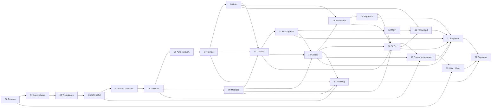
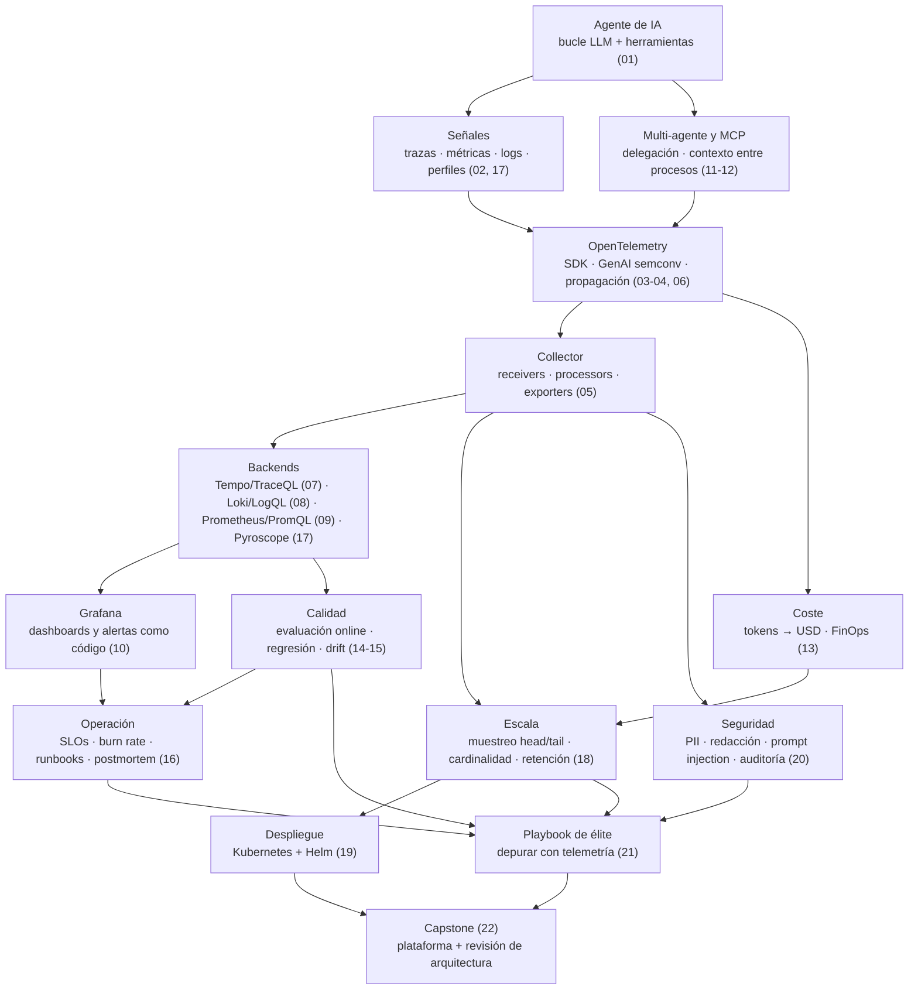

# Guía de estudio · Observabilidad de agentes de IA en producción

Cómo recorrer los 23 módulos (00-22) sin perderte, cuánto tiempo reservar de verdad, qué hacer cuando te atascas y cómo se corresponde el curso con lo que pediste. Esta guía **no añade contenido técnico**: ordena el que ya está en los módulos.

> **Sobre las horas.** El README anuncia ≈ 100 h (≈ 4,3 h por módulo) y las cabeceras de los cuadernos suman ≈ 105 h. Contando el número de celdas y la densidad de cada módulo, el tiempo *real* de un alumno que parte de cero en Docker, agentes y observabilidad es **≈ 115-120 h** con todas las ampliaciones (≈ 118 h sumando las estimaciones de los tres revisores pedagógicos) y **≈ 60 h** si sigues la ruta núcleo de abajo. Son **estimaciones razonadas**, no mediciones con alumnos: ajusta tu ritmo tras el módulo 03.

## 1. Cómo estudiar cada módulo (el ciclo de 6 pasos)

Cada módulo tiene dos cuadernos: la **lección** `NN_slug.ipynb` y el **proyecto** `NN_proyecto_*.ipynb`. El ciclo recomendado, dividido en **dos sesiones** de 2-3 h:

| Sesión | Paso | Qué haces | Por qué funciona |
|---|---|---|---|
| **A · Lección** (≈ 2,5-3 h) | 1. **Recuperar** (10 min) | Antes de leer, responde de memoria las preguntas de la caja **🔁 Conexión con módulos anteriores** y despliega la respuesta | La *práctica de recuperación* fija lo previo mejor que releerlo |
| | 2. **Leer y ejecutar** | Sigue el orden de cada lección: intuición → ejemplo a mano → fórmula → implementación → industria → experimento. Ejecuta todas las celdas y **predice** el resultado antes de ver el gráfico; lee la caja **👀 Qué debes observar** | El ejemplo resuelto antes de la abstracción reduce la carga cognitiva |
| **B · Proyecto** (≈ 1,75-2 h) | 3. **Proyecto sin mirar la solución** | Lee el contexto de negocio y la rúbrica, y completa los TODO en orden. La rúbrica se ejecuta en el propio cuaderno | Aprender haciendo (50 % del curso) |
| | 4. **Pistas 🪜 solo si te atascas** | Pista 1 orienta la idea; Pista 2 casi da la API. Nunca abras el ⛔ SPOILER antes de pasar la rúbrica | Andamiaje graduado: la ayuda se retira poco a poco |
| | 5. **Autoevaluación** (20 min) | Las preguntas de **Cálculo**, **Diagnóstico** y **Transferencia** al final de la lección; responde por escrito antes de desplegar | Comprueba que puedes *aplicar*, no solo recordar |
| **Repaso espaciado** | 6. **Mini-repaso** (10-15 min) | Al día siguiente, a la semana y al mes: vuelve a las preguntas 🔁 y a tus errores de la rúbrica | El espaciado consolida; cada lección vuelve a preguntar por módulos anteriores |

Reglas de oro: **ejecuta** los cuadernos (leerlos no basta); **escribe** tus predicciones; si una celda falla, lee primero el mensaje de `check_stack()` (dice qué servicio falta y el comando exacto) y solo después pide ayuda.

## 2. Mapa del curso, tiempos y niveles

Niveles del README: 🟢 Básico · 🟡 Intermedio · 🟠 Avanzado · 🔴 Experto. «Núcleo» = horas si haces solo la ruta núcleo del módulo (caja 🧭 de su lección, o las secciones que exige el proyecto).

| Módulo | Nivel | Cabecera | **Horas reales** | Núcleo | Prerrequisitos directos | Qué construyes (proyecto) |
|---|---|---|---|---|---|---|
| 00 Entorno | 🟢 | 4 h | **4,5 h** | 3,5 h | Python | Stack arriba y primer dashboard |
| 01 Agente base | 🟢 | 4,3 h | **5 h** | 3,5 h | 00 | SupportOps extendido y 3 fallos reproducidos |
| 02 Tres pilares | 🟢 | 4,5 h | **5 h** | 3,5 h | 00, 01 | Clasificar 10 incidentes por señal |
| 03 SDK de OTel | 🟡 | 4,5 h | **5,5 h** | 4 h | 01, 02 | SupportOps v0 instrumentado |
| 04 Convenciones GenAI | 🟡 | 4,5 h | **5 h** | 3,5 h | 03 | Modelo del agente validado con un linter |
| 05 Collector | 🟡 | 4,5 h | **5,5 h** | 4 h | 00, 03, 04 | Collector que exporta a los tres backends |
| 06 Auto-instrumentación | 🟡 | 4,5 h | **5 h** | 3,5 h | 01, 03-05 | Matriz de decisión manual vs auto |
| 07 Tempo y TraceQL | 🟡 | 4,5 h | **6 h** | 4,5 h | 03-06 | Consultas de diagnóstico sobre trazas |
| 08 Loki y LogQL | 🟡 | 4,5 h | **5 h** | 4,5 h | 02, 05, 07 | Pipeline de logs correlacionados |
| 09 Métricas | 🟡 | 4,5 h | **5,5 h** | 4,5 h | 02-05 | Métricas de negocio y de modelo |
| 10 Grafana | 🟡 | 4,5 h | **5 h** | 4,5 h | 07, 08, 09 | Dashboard «Salud del agente» |
| 11 Multi-agente | 🟠 | 5 h | **5,5 h** | 4,5 h | 02-04, 07-10 | Multi-agente rastreado de extremo a extremo |
| 12 MCP y herramientas | 🟠 | 5 h | **5,5 h** | 4 h | 03, 04, 11 | Servidor MCP de pedidos instrumentado |
| 13 Costes y FinOps | 🟠 | 4,5 h | **4,5 h** | 4,5 h | 03, 04, 09-11 | Panel de FinOps con alerta de desvío |
| 14 Evaluación online | 🟠 | 4,5 h | **5 h** | 5 h | 04, 08-10, 13 | Evaluador online con métricas en Grafana |
| 15 Calidad y regresión | 🟠 | 4,5 h | **5 h** | 5 h | 07, 09, 13, 14 | Regresión de prompt detectada con telemetría |
| 16 SLOs, alertas, incidentes | 🟠 | 4,5 h | **4,5 h** | 4,5 h | 09, 10, 13-15 | SLOs, alerta multiventana, runbook y postmortem |
| 17 Profiling | 🟠 | 4,5 h | **5 h** | 3,5 h | 03, 07, 09, 13 | Cuello de botella de CPU arreglado |
| 18 Escala, muestreo, coste | 🔴 | 5 h | **5,5 h** | 3,5 h | 05, 07-09, 13, 16 | Política de muestreo y retención con presupuesto |
| 19 Kubernetes + Helm | 🔴 | 5 h | **5,5 h** | 3,5 h | 00, 05, 18 | Stack y SupportOps desplegados como código |
| 20 Privacidad y seguridad | 🔴 | 4,5 h | **5,5 h** | 3 h | 04, 05, 08, 12, 16 | Pipeline de redacción y alertas de inyección |
| 21 Playbook de élite | 🔴 | 4,5 h | **5 h** | 3,5 h | 03, 09, 11, 13, 15, 16, 18, 20 | «Mesa de incidentes»: 5 incidentes sin pistas |
| 22 Capstone | 🔴 | 4,5 h | **4,5 h** | 3 h | todo (sobre todo 05, 09, 11, 14, 16, 18-21) | Plataforma completa y revisión de arquitectura |
| | | **≈ 105 h** | **≈ 118 h** | **≈ 60 h** (solo los módulos de la ruta núcleo, §3.1) | | |

Notas: los módulos **09 y 11** (≈ 100 y ≈ 90 celdas) y **20 y 21** (≈ 84 y ≈ 79) son los más cargados; usa su caja 🧭 / dos sesiones. El **19** es el primero que exige tener `helm` y, idealmente, `kind`/`k3d` (si no, funciona con los datos pregrabados). Las horas reales de 00-07, 08-15 y 16-22 salen de los informes de revisión pedagógica 1, 2 y 3 (`_tools/REVISION_PEDAGOGICA_*.md`): un alumno que parte de cero necesita ≈ 1 h más que la cabecera en los módulos con más Docker o más conceptos nuevos (03, 05, 07, 09, 11, 12, 18-20), incluidas las primeras descargas y los fallos normales.

### Prerrequisitos entre módulos

Lectura rápida: **00-05** es el tronco (nada se puede saltar); **07-10** son los backends y Grafana (necesitas los tres antes del 10); **11-15** dependen de 09-10; **16-17** se pueden hacer en cualquier orden una vez superado el 15 (el 17 solo pide 03, 07, 09 y 13); **18-20** son independientes entre sí tras el 16 salvo que el 19 usa el muestreo del 18; **21-22** cierran el curso y reutilizan casi todo.

### Mapa de conceptos

## 3. Itinerarios

### 3.1 Ruta núcleo (≈ 60 h): lo mínimo para operar un agente con este stack
Módulos **00-05, 06 (núcleo: conceptos y matriz de decisión), 07-10, 13, 16, 18 (núcleo §1-8 y §12), 21 (núcleo: método + 5 casos)**. Para cada módulo hazlo con su caja 🧭 de ruta núcleo. Te deja con: un agente instrumentado, un pipeline de Collector, consultas en Tempo/Loki/Prometheus, un dashboard, un SLO con alerta multiventana, control de coste y un método de depuración. **No** cubre multi-agente (11-12), evaluación online (14-15), profiling (17), Kubernetes (19), privacidad (20) ni capstone (22).

### 3.2 Ruta completa (≈ 115-120 h)
Todos los módulos en orden, con sus ampliaciones. Es el camino hacia el nivel «experto de empresa top» y la única que incluye el capstone.

### 3.3 Por objetivo
La tabla corrige un detalle de las rutas del README: **no se puede hacer el 10 sin 07 y 08** ni el 22 sin 16 y 20, así que se añaden.

| Objetivo | Módulos | Horas | Para qué te sirve |
|---|---|---|---|
| **Trabajo actual** (tengo agentes en producción que monitorear) | 00-05, **07-10**, 13, **14-15** (calidad: tu mayor riesgo silencioso), 16, 18, 20, 21; 11-12 si tu sistema es multi-agente o usa MCP | ≈ 87 h (+ 11 h con 11-12) | Instrumentar con el estándar, ver trazas/logs/métricas, calidad y coste, SLOs y alertas, privacidad e incidentes |
| **Producto propio** (observabilidad barata y seria desde el día 1) | 00-10, 13, 16, 18, 19, 20, 22 (21 recomendado) | ≈ 87 h (+ 5 h con el 21) | Stack propio versionable, coste controlado, despliegue como código y una revisión de arquitectura defendible |
| **Entrevistas / system design** | Ruta núcleo + 11, 14-15, 18, 21, 22 y `extras/ENTREVISTAS_SYSTEM_DESIGN.md` | ≈ 85 h | Diseño de plataforma, trade-offs y casos de fallo |
| **Tengo poco tiempo, solo quiero depurar mejor** | 02, 07, 08, 21 (lección) | ≈ 18 h | Método de análisis, TraceQL/LogQL y los cinco patrones de fallo |

Después de cualquier ruta: `extras/RUTA_DE_CARRERA.md` (roles, certificaciones, comunidad) y `21_elite_playbook/COMPENDIO_SECRETOS.md` como lista de comprobación antes de cada despliegue.

## 4. Calendarios sugeridos
Una **sesión** = 2-3 h. Las semanas marcan horas aproximadas; si una semana se te hace pesada, pasa lo que no cabe a la siguiente: lo importante es la constancia, no la velocidad. Cada semana reserva 15 min para el repaso espaciado (§1 paso 6).

### 4.1 En 8 semanas · ruta núcleo (≈ 60 h, 7-8 h por semana)
| Semana | Módulos | Horas | Hito de salida |
|---|---|---|---|
| 1 | 00, 01 | 7 | Stack arriba y SupportOps con 3 fallos reproducidos |
| 2 | 02, 03 | 7,5 | Primeras trazas de tu agente |
| 3 | 04, 05 | 7,5 | Collector exportando a los tres backends |
| 4 | 06 (núcleo), 07 | 8 | Diagnóstico con TraceQL |
| 5 | 08, 09 | 9 | Logs con `trace_id` y métricas de negocio |
| 6 | 10, 13 | 9 | Dashboard «Salud del agente» y alerta de coste |
| 7 | 16, 18 (núcleo) | 8 | SLO con alerta multiventana y política de muestreo |
| 8 | 21 (núcleo) + repaso | 5 | Resolver ≥ 3 incidentes de la mesa; repasa tus errores |

### 4.2 En 12 semanas · ruta completa (≈ 118 h, ≈ 10 h por semana)
| Semana | Módulos | Horas |
|---|---|---|
| 1 | 00, 01 | 9,5 |
| 2 | 02, 03 | 10,5 |
| 3 | 04, 05 | 10,5 |
| 4 | 06, 07 | 11 |
| 5 | 08, 09 | 10,5 |
| 6 | 10, 11 | 10,5 |
| 7 | 12, 13 | 10 |
| 8 | 14, 15 | 10 |
| 9 | 16, 17 | 9,5 |
| 10 | 18, 19 | 11 |
| 11 | 20, 21 | 10,5 |
| 12 | 22 + extras (entrevistas, carrera) + repaso general | 8 |

### 4.3 En 16 semanas · ruta completa (≈ 118 h, ≈ 7,5 h por semana)
Aquí algunos módulos se parten en sus dos sesiones (A = lección, B = proyecto).

| Semana | Contenido | Semana | Contenido |
|---|---|---|---|
| 1 | 00 · 01 (A) | 9 | 11 (B) · 12 (A) |
| 2 | 01 (B) · 02 | 10 | 12 (B) · 13 |
| 3 | 03 · 04 (A) | 11 | 14 · 15 (A) |
| 4 | 04 (B) · 05 | 12 | 15 (B) · 16 |
| 5 | 06 · 07 (A) | 13 | 17 · 18 (A) |
| 6 | 07 (B) · 08 | 14 | 18 (B) · 19 (A) |
| 7 | 09 | 15 | 19 (B) · 20 |
| 8 | 10 · 11 (A) | 16 | 21 · 22 (el capstone puede ocupar una semana 17 de colchón) |

Las semanas 14-16 son las más densas (≈ 8-10 h): son los módulos 🔴.

## 5. Qué hacer si te atascas (escalera de ayuda)
1. **Lee el error y `check_stack()`.** La primera celda de cada cuaderno dice qué servicio falta y el comando exacto. Recuerda: «arrancado» no es «listo» (Loki tarda ≈ 17 s y Pyroscope ≈ 1 min en estar disponibles; un `200` del Collector solo prueba que aceptó). Ejecuta siempre `docker compose` desde `stack/` y con `--profile`.
2. **Vuelve a la sección de la lección del TODO.** Cada TODO reutiliza algo mostrado antes (el proyecto 22 incluso trae una tabla «Qué reutilizas de cada módulo»). Busca el ejemplo a mano de esa idea.
3. **Abre la 🪜 Pista 1**, inténtalo 10 minutos; si no, **Pista 2**.
4. **Reduce el problema.** Ejecuta tu función con una entrada diminuta (3 spans, 5 tickets) y compárala con el ejemplo a mano de la lección. Usa `FAST_DEV_RUN = True` para iterar rápido.
5. **Modo degradado.** Sin Docker, con poca RAM o con un puerto ocupado, el cuaderno funciona con datos pregrabados (el cuaderno lo indica). Los laboratorios efímeros de los módulos 05, 18, 19, 20 y 22 usan puertos aleatorios.
6. **Solución de referencia como último recurso**, después de un intento serio: léela *para comparar*, cierra el cuaderno, y reescribe tu versión sin mirarla. Anota qué te faltaba en tu lista de repaso.
7. **Si lo conceptual no encaja** (p. ej. burn rate o tail sampling), vuelve a la analogía de la caja 💡 de la lección (ML, backend o SRE) y a su ejemplo numérico; después rehaz la pregunta de **Cálculo** de la autoevaluación.
8. **Si estás bloqueado más de 30 minutos en un mismo TODO**, pasa al siguiente (los TODO suelen ser independientes), termina la rúbrica y vuelve con la cabeza fría.

Problemas típicos de entorno: RAM insuficiente (arranca solo `--profile core`; el perfil completo necesita ≈ 8 GB libres), Grafana en `localhost:3000` con `admin`/`admin`, y trabajar con varias sesiones a la vez en la misma máquina (usa el candado `flock /tmp/obs-stack.lock …` y no levantes dos stacks). El módulo 19 documenta qué se probó y qué **no** en un clúster real.

## 6. Hitos de dominio por bloque (¿estás listo para seguir?)
- **Tras el bloque A (00-02):** puedes explicar por qué un agente rompe el monitoreo clásico, levantar el stack, y decidir si un síntoma lo ve mejor una traza, una métrica o un log.
- **Tras el bloque B (03-06):** tu agente emite trazas con `gen_ai.*`, propagas el contexto entre procesos, y sabes cuándo usar instrumentación manual y cuándo automática.
- **Tras el bloque C (07-10):** consultas trazas con TraceQL, logs con LogQL y métricas con PromQL, y tienes un dashboard y una alerta como código.
- **Tras el bloque D (11-17):** operas un multi-agente, controlas el coste, mides la calidad online, defines SLOs con burn rate y perfilas CPU.
- **Tras el bloque E (18-22):** sabes muestrear sin sesgar métricas, desplegar como código, proteger la PII, depurar incidentes sin pistas y **defender** una arquitectura de observabilidad.

## 7. Qué módulo cubre cada criterio de éxito que pediste

| Tu criterio (palabras del brief) | Dónde se cubre |
|---|---|
| «Crear un curso de monitoreo de agentes en producción con el stack OpenTelemetry, Grafana, Loki, Tempo» | 03-05 (OTel + Collector), 07 (Tempo), 08 (Loki), 10 (Grafana); 22 integra todo |
| Nivel final «experto de empresa top» | Bloque E (18-22), 🧠 secretos por módulo, `COMPENDIO_SECRETOS.md` (74 secretos con fuente) y la mesa de incidentes (21) como examen |
| «Trabajo actual» | Ruta «trabajo actual» (§3.3): 13-16, 18, 20, 21 sobre la base 00-10 |
| «Emprender / producto propio» | Ruta «producto propio» (§3.3): 18 (coste), 19 (K8s + Helm), 22 (revisión de arquitectura) |
| «Equilibrado, hands-on» (30 % conceptos · 50 % implementación · 20 % operación y fallos) | Cada módulo: lección (conceptos y a mano), proyecto con rúbrica (implementación) y casos de fallo (16, 21) |
| «Sección por módulo y módulo propio» de élite | Caja 🧠 en cada lección + módulo 21 + compendio |
| «Hasta lo publicado este año», marcando lo experimental | 04 (semconv GenAI en *Development*, instantánea fechada), 12 (MCP), 17 (OpenTelemetry Profiles, alfa), 06 y cada «Honestidad técnica» |
| «Notebooks + docker-compose», «mi máquina con Docker» | 00 (Docker y Compose desde cero), `stack/`, `check_stack()` y modo degradado en cada cuaderno |
| «~100 h, 16+ módulos» | 23 módulos, ≈ 105 h anunciadas y ≈ 118 h reales (ver §2) |
| «LLM agnóstico de proveedor» | 01 (variable `LLM_PROVIDER`: mock, anthropic, openai u ollama; `mock`, determinista, en las rúbricas) |
| Profundizar «calidad y evaluación online» | 14 (LLM-juez, sesgos, coste de evaluar) y 15 (regresión, drift, canario, A/B); recuperada en 16 (SLO de calidad) y 21 (caso C) |
| Profundizar «multi-agente y MCP» | 11 (orquestación, handoffs, cascadas) y 12 (trazas a través de servidores MCP, seguridad de herramientas); reutilizados en 21 (caso A) y 22 |
| Lo que más aporte profesional (escala, muestreo y coste del propio stack) | 18 (tail sampling, cardinalidad, multi-tenant, retención, coste), 13 (FinOps) |
| Añadir «Profiling continuo (Pyroscope)» | 17 |
| Añadir «Kubernetes + Helm» | 19 (incluye una introducción a Kubernetes para quien nunca lo usó) |
| «Solo lo pedido + opcionales» (Prometheus/Mimir, OpenLIT/OpenLLMetry) | 09 (métricas), 06 (auto-instrumentación) |
| Hilo «SupportOps», «generador de tráfico sintético propio» | 01 crea el agente y el generador de tráfico con fallos; todos los proyectos usan semilla fija |
| «Plantilla con TODOs + pistas graduadas + solución oculta» | Todos los proyectos: TODO, 🪜 Pista 1/2, rúbrica ejecutable y ⛔ SPOILER |
| «Capstone final» | 22 (rúbrica integral y revisión de arquitectura) |
| «Guía de entrevistas / system design» | `extras/ENTREVISTAS_SYSTEM_DESIGN.md` |
| «Ruta de carrera / certificaciones» | `extras/RUTA_DE_CARRERA.md` |

## 8. Glosario ES / EN de los términos clave
El curso usa el término en inglés cuando es el habitual en la industria (*span*, *tail sampling*…) y lo explica en español. «Mód.» = módulo donde se introduce.

| Inglés (el que verás en herramientas) | Español usado en el curso | Qué es en una línea | Mód. |
|---|---|---|---|
| **observability** | observabilidad | Capacidad de entender el estado interno de un sistema a partir de su telemetría | 00, 02 |
| **telemetry** | telemetría | Datos que emite el sistema sobre sí mismo (trazas, métricas, logs, perfiles) | 02 |
| **trace** | traza | El recorrido completo de una petición por el sistema (árbol de spans) | 02, 03 |
| **span** | span (tramo) | Una operación con inicio, duración, atributos y estado dentro de una traza | 02, 03 |
| **attribute** | atributo | Par clave-valor de un span (`gen_ai.request.model`); alta cardinalidad permitida | 03 |
| **resource / scope** | recurso / ámbito | Quién emite (servicio, versión) / qué librería instrumenta | 02, 03 |
| **context propagation** | propagación de contexto | Pasar el `traceparent` (W3C Trace Context) entre procesos para no partir la traza | 03, 11 |
| **baggage** | *baggage* | Pares clave-valor que viajan con el contexto (úsalo con cuidado: no es secreto) | 11 |
| **semantic conventions (semconv)** | convenciones semánticas | Nombres estándar de atributos y spans (`gen_ai.*`, estado *Development*) | 04 |
| **OTLP** | OTLP | Protocolo de OpenTelemetry para enviar telemetría (gRPC/HTTP) | 03, 05 |
| **collector** | Collector | Proceso que recibe, transforma y exporta telemetría | 05 |
| **receiver / processor / exporter / connector** | receptor / procesador / exportador / conector | Piezas de un pipeline del Collector | 05 |
| **gateway / agent** | *gateway* / agente (del Collector) | Collector centralizado / Collector local por nodo | 05, 19 |
| **auto-instrumentation** | auto-instrumentación | Instrumentar sin tocar código (OpenLIT, OpenLLMetry) | 06 |
| **TraceQL / LogQL / PromQL** | TraceQL / LogQL / PromQL | Lenguajes de consulta de Tempo / Loki / Prometheus | 07, 08, 09 |
| **label vs structured metadata** | etiqueta vs *structured metadata* | Índice de Loki (baja cardinalidad) vs dato adjunto sin indexar | 08 |
| **metric / counter / gauge / histogram** | métrica / contador / gauge / histograma | Series temporales agregadas; el histograma guarda la distribución | 02, 09 |
| **cardinality** | cardinalidad | Nº de valores/combinaciones distintas de etiquetas; define el coste de las series | 09, 18 |
| **exemplar** | *exemplar* | Punto de una métrica que enlaza a una traza concreta | 09, 10 |
| **percentile (p50/p95/p99)** | percentil | Valor bajo el cual está ese % de las observaciones; nunca se promedia | 09 |
| **dashboard as code / provisioning** | dashboards como código / aprovisionamiento | Dashboards y alertas definidos en ficheros versionados | 10 |
| **data link / correlation** | enlace de datos / correlación | Salto de un panel a la traza, el log o el perfil relacionados | 10 |
| **orchestrator / subagent / handoff** | orquestador / subagente / traspaso | Patrones multi-agente: delegar con retorno vs transferir el control | 11 |
| **MCP (Model Context Protocol)** | MCP | Protocolo para conectar herramientas a agentes | 12 |
| **tool call** | llamada a herramienta | El agente invoca una función externa (consultar un pedido) | 01, 12 |
| **token / prompt caching** | token / caché de prompts | Unidad de coste del LLM / reutilización de prefijo a menor precio | 13 |
| **FinOps / unit economics** | FinOps / unidad económica | Gestión del coste; p. ej. USD por ticket resuelto | 13 |
| **LLM-as-judge / online evaluation** | LLM como juez / evaluación online | Un modelo puntúa las respuestas en producción, normalmente sobre una muestra | 14 |
| **groundedness / hallucination** | fundamentación / alucinación | La respuesta se apoya en las fuentes / se inventa | 14 |
| **regression / drift / canary** | regresión / deriva / canario | Empeoramiento tras un cambio / cambio gradual de los datos / despliegue parcial para comparar | 15 |
| **SLI / SLO / SLA** | SLI / SLO / SLA | Indicador / objetivo interno / contrato con el cliente | 16 |
| **error budget** | presupuesto de error | Fracción de eventos que pueden fallar sin incumplir el SLO (1 − objetivo) | 16 |
| **burn rate** | *burn rate* (ritmo de consumo del presupuesto) | Cuántas veces más rápido que lo permitido se está gastando el presupuesto | 16 |
| **multi-window alert** | alerta multiventana | Burn rate en ventana larga **y** corta para evitar ruido y rearmes lentos | 16 |
| **runbook / postmortem (blameless)** | runbook / postmortem (sin culpa) | Guía de respuesta a una alerta / análisis posterior centrado en el sistema | 16 |
| **on-call** | guardia | Turno de respuesta a alertas | 16 |
| **flamegraph / profile** | flamegraph / perfil | Visualización de dónde gasta CPU el código (ancho = muestras) | 17 |
| **head sampling / tail sampling** | muestreo por cabeza / por cola (*tail sampling*) | Decidir al empezar la traza / cuando está completa (por errores, latencia, coste) | 18 |
| **inclusion probability / weights (1/π)** | probabilidad de inclusión / pesos | Corrección del sesgo que introduce muestrear por valor | 18 |
| **tenant** | *tenant* (inquilino) | Frontera de aislamiento y de límites en Loki/Tempo | 18 |
| **retention / tiering** | retención / niveles (*tiering*) | Cuánto se guarda y en qué almacenamiento (caliente/frío) | 18 |
| **DaemonSet / Deployment / StatefulSet** | DaemonSet / Deployment / StatefulSet | Pod por nodo / réplicas sin estado / réplicas con identidad y disco | 19 |
| **Helm chart / values / release** | *chart* / *values* / *release* | Paquete de plantillas / sus parámetros / una instalación | 19 |
| **HPA** | HPA | Autoescalado horizontal de pods por métrica | 19 |
| **operator / CRD** | *operator* / CRD | Controlador que gestiona un tipo de recurso propio (p. ej. el Collector) | 19 |
| **PII (personally identifiable information)** | datos personales (PII) | Datos que identifican a una persona | 20 |
| **redaction / pseudonymization** | redacción / seudonimización | Borrar o enmascarar un dato / sustituirlo por un identificador estable (HMAC) | 20 |
| **prompt injection** | inyección de prompt | Texto que hace que el modelo trate datos como instrucciones | 20 |
| **audit trail (hash chain)** | registro de auditoría (cadena de hashes) | Registro append-only a prueba de manipulación | 20 |
| **bubble-up** | *bubble-up* | Comparar casos malos con buenos para ver qué atributo los distingue | 21 |
| **telemetry contract** | contrato de telemetría | Afirmación comprobable sobre la telemetría («una traza por ticket») | 21, 22 |
| **ADR (architecture decision record)** | ADR / registro de decisión | Documento corto: contexto, decisión, alternativas, consecuencias | 22 |
| **scorecard / production readiness** | *scorecard* / preparación para producción | Medición automática + checklist antes de aceptar un servicio en guardia | 22 |
| **ground truth** | verdad de terreno | Etiqueta o valor real conocido (en el laboratorio, la simulación lo conoce) | varios |

## 9. Consejos finales
- **El stack es el objetivo, no el obstáculo.** Si algo no arranca, no pases de módulo: casi todos los cuadernos dependen del anterior.
- **Escribe tus propios incidentes.** A partir del 16, inventa un fallo nuevo y pide a alguien (o a ti dentro de una semana) que lo diagnostique solo con telemetría: es el mejor entrenamiento de guardia.
- **Usa el compendio como lista de comprobación**, no como lectura lineal, antes de cada despliegue real.
- **Verifica lo experimental.** Convenciones GenAI, MCP y OpenTelemetry Profiles están marcadas como *Development* / alfa: comprueba su estado en el repositorio oficial antes de fijar nombres de atributos en producción.
