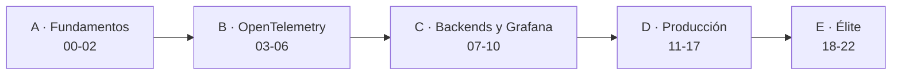

# Observabilidad de agentes de IA en producción
**OpenTelemetry · Grafana · Loki · Tempo** — de cero a experto, con un agente de soporte («SupportOps») que crece módulo a módulo.

> **Estado: contenido completo (módulos 00-22 + extras).** Pendiente de la revisión pedagógica final (la guía de estudio la redacta el revisor pedagógico).
> Todo se verificó con el stack real en Docker (Collector 0.162.0, Tempo 3.1.0, Loki 3.7.8, Prometheus 3.15.0, Grafana 13.2.4, Pyroscope 2.1.2) **salvo** lo indicado en cada módulo: en particular los adaptadores de proveedores LLM reales (probados solo con clientes falsos) y
> los **pods en un clúster de Kubernetes** (el entorno de construcción no pudo ejecutarlos; módulo 19). Los datos son sintéticos, el LLM por defecto es un `mock` determinista y los precios son ilustrativos.

## Para quién
Personas con Python sólido que **no** han usado agentes LLM, Docker ni observabilidad, y quieren llegar a nivel experto para operar agentes reales (trabajo actual) o montar su propio producto con observabilidad seria.

## Mapa del curso


## Módulos (≈ 4,3 h cada uno · ≈ 100 h en total)

Niveles: 🟢 Básico · 🟡 Intermedio · 🟠 Avanzado · 🔴 Experto. Cada módulo tiene `README.md`, la **lección** `NN_slug.ipynb` y el **proyecto** `NN_proyecto_*.ipynb` (plantilla con TODOs, pistas 🪜, rúbrica con umbrales medidos y solución tras ⛔ SPOILER).

| Nivel | Módulo | Qué aprendes | Proyecto |
|---|---|---|---|
| 🟢 | [00 · Entorno](00_entorno/) | Por qué los agentes rompen el monitoreo clásico; Docker/Compose; el stack | Levantar el stack y un primer dashboard |
| 🟢 | [01 · Agente base](01_agente_base/) | Agente = bucle LLM + herramientas; `supportops`; tráfico y fallos sintéticos | Extender SupportOps y reproducir 3 fallos |
| 🟢 | [02 · Tres pilares](02_tres_pilares/) | Trazas, métricas y logs; modelo de datos de OTel; golden signals de agentes | Clasificar 10 incidentes por señal |
| 🟡 | [03 · SDK de OTel (Python)](03_otel_sdk_python/) | Spans, contexto, propagación W3C, exportación OTLP, a mano antes que con librerías | Instrumentar SupportOps v0 |
| 🟡 | [04 · Convenciones GenAI](04_genai_semconv/) | `gen_ai.*`, operaciones, tokens, contenido *opt-in*; estable vs *Development* | Modelar el agente y validar con un linter |
| 🟡 | [05 · Collector](05_collector/) | Receivers, processors, exporters, pipelines, gateway vs agent | Collector que exporta a los tres backends |
| 🟡 | [06 · Auto-instrumentación](06_autoinstrumentacion/) | OpenLIT y OpenLLMetry frente a la instrumentación manual | Matriz de decisión manual vs auto |
| 🟡 | [07 · Tempo y TraceQL](07_tempo_traceql/) | Arquitectura de Tempo, TraceQL, service graph | Consultas de diagnóstico sobre trazas con fallos |
| 🟡 | [08 · Loki y LogQL](08_loki_logql/) | Etiquetas vs *structured metadata*, LogQL, logs con `trace_id` | Pipeline de logs correlacionados |
| 🟡 | [09 · Métricas](09_metricas/) | Prometheus, instrumentos, histogramas, exemplars, cardinalidad | Métricas de negocio y de modelo |
| 🟡 | [10 · Grafana](10_grafana/) | Dashboards como código, variables, correlaciones, alertas | Dashboard «Salud del agente» |
| 🟠 | [11 · Multi-agente](11_multiagente/) | Orquestador y subagentes, handoffs, contexto entre procesos, cascadas | Multi-agente rastreado de extremo a extremo |
| 🟠 | [12 · MCP y herramientas](12_mcp_tools/) | Trazas a través de servidores MCP; seguridad de herramientas | Instrumentar un servidor MCP de pedidos |
| 🟠 | [13 · Costes y FinOps](13_costes_finops/) | Tokens → coste, atribución, presupuestos, caché, bucles caros | Panel de FinOps con alerta de desvío |
| 🟠 | [14 · Evaluación online](14_evaluacion_online/) | LLM-juez como spans/eventos, muestreo, sesgos, coste de evaluar | Evaluador online con métricas en Grafana |
| 🟠 | [15 · Calidad y regresión](15_calidad_regresion/) | Datasets desde trazas, regresiones, drift, canarios, A/B | Detectar una regresión de prompt solo con telemetría |
| 🟠 | [16 · SLOs, alertas e incidentes](16_slos_alertas_incidentes/) | SLIs/SLOs de agentes, burn rate multiventana, runbooks, postmortems | SLOs, alertas, runbook y postmortem |
| 🟠 | [17 · Profiling (Pyroscope)](17_profiling_pyroscope/) | Cuarto pilar: flamegraphs, traza ↔ perfil, rutas calientes | Arreglar un cuello de botella de CPU |
| 🔴 | [18 · Escala, muestreo y coste](18_escala_muestreo_coste/) | Head vs tail sampling, cardinalidad, multi-tenant, retención, coste del stack | Política de muestreo y retención con presupuesto |
| 🔴 | [19 · Kubernetes + Helm](19_kubernetes_helm/) | Collector, backends y agentes con Helm; Operator; configuración como código | Desplegar el stack y SupportOps (ver límites en su README) |
| 🔴 | [20 · Privacidad y seguridad](20_privacidad_seguridad/) | PII en telemetría, `redaction`/OTTL, captura de contenido, prompt injection, auditoría, retención | Pipeline de redacción y alertas de inyección |
| 🔴 | [21 · Playbook de élite](21_elite_playbook/) | Depuración de producción: cascadas, bucles, regresiones silenciosas, cardinalidad, trazas partidas; cultura; **compendio de secretos** | «Mesa de incidentes»: 5 incidentes sin pistas |
| 🔴 | [22 · Capstone](22_capstone/) | Plataforma completa: instrumentación, gateway, SLOs, calidad, coste, privacidad, muestreo, despliegue, checklist y revisión de arquitectura | Entrega final con rúbrica integral |

**Extras:** [`extras/ENTREVISTAS_SYSTEM_DESIGN.md`](extras/ENTREVISTAS_SYSTEM_DESIGN.md) (36 preguntas, 3 diseños de referencia y ejercicios de pizarra) · [`extras/RUTA_DE_CARRERA.md`](extras/RUTA_DE_CARRERA.md) (roles, certificaciones y comunidad, con lo no verificable marcado) · [`21_elite_playbook/COMPENDIO_SECRETOS.md`](21_elite_playbook/COMPENDIO_SECRETOS.md) · `GUIA_DE_ESTUDIO.md` (ruta, tiempos, glosario: la redacta el revisor pedagógico).

## Prerrequisitos
- **Python ≥ 3.10** y conocimientos sólidos de Python (nada más: no se asume OTel, agentes, Docker ni observabilidad).
- **Docker** con Compose v2 (probado con Docker 29.8) con ≈ 8 GB de RAM libres para el stack completo (el perfil `core` ≈ 0,4 GB en reposo). Sin GPU. Sin Docker, todos los notebooks funcionan en **modo degradado** (datos pregrabados o simulación en memoria) salvo las secciones que lo indican.
- Un kernel de Jupyter local (Jupyter o VS Code). Los badges de Colab sirven solo para partes sin Docker.
- Para el módulo 19: `helm` ≥ 4 y `kind`/`k3d` (opcional; el módulo documenta qué se verifica sin clúster).
- **Ninguna API key** es necesaria (`LLM_PROVIDER=mock`). Si usas un proveedor real, solo por variables de entorno.

## Instalar el paquete `supportops`
Desde la raíz del repositorio:
```bash
python -m venv .venv && source .venv/bin/activate
pip install -e "agent-observability-course[viz,otel,mcp,nb,dev]"
python -m pytest agent-observability-course/supportops/tests -q      # las pruebas que usan Docker/Helm se saltan si no están
```
Extras de `pyproject.toml`: `viz` (matplotlib, numpy, pandas, pyyaml) · `nb` (lo anterior + ipykernel, nbformat, nbclient) · `otel` (opentelemetry-sdk ≥ 1.39 + exportador OTLP/HTTP) · **`mcp` (`mcp>=2,<3`: lo instala la lección 12; probado con 2.2.0 y 2.3.0)** · `anthropic` · `openai` · `dev` (pytest).
Algunos módulos instalan en su primera celda dependencias propias: 06 (`openai openlit traceloop-sdk opentelemetry-instrumentation-genai-openai`), 17 (`pyroscope-io pyroscope-otel`).

## Ejecutar el stack
Ejecuta siempre desde `agent-observability-course/stack/` (sin `--profile` no arranca nada):
```bash
cd agent-observability-course/stack
docker compose --profile core up -d                              # Collector, Tempo, Loki, Grafana
docker compose --profile core --profile metrics up -d            # + Prometheus (módulos 09, 13, 16, 18, 20-22)
docker compose --profile all up -d                               # + Pyroscope (módulo 17)
docker compose --profile all down            # parar (conserva datos) · añade -v para borrarlos
```
Grafana: <http://localhost:3000> (`admin` / `admin`; en Grafana 13 el acceso anónimo solo puede ser *Viewer*). Puertos: OTLP 4317/4318, Collector 13133/8888/8889, Tempo 3200, Loki 3100, Prometheus 9090, Pyroscope 4040. Cada notebook empieza con `check_stack()` que dice qué falta y el comando exacto.
**Compartir máquina:** el stack usa puertos fijos; si trabajas con varias sesiones a la vez, usa un candado (`flock /tmp/obs-stack.lock …`) y no levantes dos stacks. Los laboratorios efímeros (módulos 05, 18, 19, 20 y 22) usan puertos aleatorios y no lo necesitan.

## Cómo estudiar
Cada módulo: leer la lección → hacer el proyecto **sin mirar la solución** (usa las pistas 🪜 solo si te atascas) → autoevaluación. Los recuadros 🧠 son el contenido de élite; **👀 Qué debes observar** va tras cada gráfico. Las rúbricas de los proyectos se ejecutan en el propio notebook y sus umbrales están medidos con la solución en modo `mock` y semilla fija.
Rutas sugeridas: **trabajo actual** → 00-05, 09-10, 13-16, 18, 20-21; **producto propio** → 00-10, 13, 18-19, 22.

## Estructura del repositorio
```
agent-observability-course/
├── NN_slug/               # README.md, lección y proyecto de cada módulo
├── extras/                # entrevistas / system design, ruta de carrera
├── supportops/            # paquete Python (agente, tráfico, instrumentores, laboratorios) + tests
├── stack/                 # docker-compose, configuraciones y dashboards 00-22 aprovisionados
└── _tools/                # COURSE_SPEC, SYLLABUS, STYLE_GUIDE, INTERFACES, builders, progreso, check_course.py
```
Los notebooks se **generan** con `_tools/builders/build_NN.py` (ejecutar desde la raíz del repositorio); no los edites a mano. `python agent-observability-course/_tools/check_course.py` revisa la estructura de todos los módulos.

## Honestidad técnica (resumen)
- **Estado del arte hasta 2026, marcando lo experimental:** las convenciones GenAI y MCP de OpenTelemetry están en *Development* (el módulo 04 incluye una instantánea fechada de la especificación). Verifica el estado actual en el repositorio de OpenTelemetry antes de fijar nombres de atributos.
- **Probado con el stack real:** Collector/Tempo/Loki/Prometheus/Grafana/Pyroscope en Docker, TraceQL/LogQL/PromQL, alertas de Grafana, Collector con `redaction`/`transform`/`tail_sampling`, configuraciones validadas con los binarios. **No probado:** adaptadores de proveedores LLM reales, pods de Kubernetes en un clúster real, Windows/WSL y arm64.
- **Simulado y determinista:** el tráfico, los incidentes, los precios (ilustrativos) y el modelo vulnerable de inyección; las cifras de los módulos son órdenes de magnitud del laboratorio, no constantes.

## Documentos de diseño
`_tools/COURSE_SPEC.md` · `_tools/SYLLABUS.md` · `_tools/STYLE_GUIDE.md` · `_tools/INTERFACES.md` · `_tools/progress/PROTOCOL.md`
