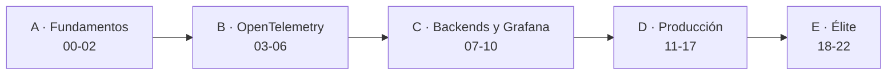

# Observabilidad de agentes de IA en producción
**OpenTelemetry · Grafana · Loki · Tempo** — de cero a experto, con un agente de soporte («SupportOps») que crece módulo a módulo.

> Estado: andamiaje listo; los módulos se están escribiendo con un equipo de agentes autores y revisores (ver `_tools/`).

## Para quién
Personas con Python sólido que **no** han usado agentes LLM, Docker ni observabilidad, y quieren llegar a nivel experto
para operar agentes reales (trabajo actual) o montar su propio producto con observabilidad seria.

## Mapa del curso

| Bloque | Módulos | Nivel |
|---|---|---|
| A · Fundamentos | 00 entorno · 01 agente base · 02 tres pilares | 🟢 |
| B · OpenTelemetry | 03 SDK Python · 04 GenAI semconv · 05 Collector · 06 auto-instrumentación | 🟡 |
| C · Backends y Grafana | 07 Tempo/TraceQL · 08 Loki/LogQL · 09 métricas · 10 Grafana | 🟡 |
| D · Producción | 11 multi-agente · 12 MCP y tools · 13 costes/FinOps · 14 evaluación online · 15 calidad y regresión · 16 SLOs, alertas e incidentes · 17 profiling (Pyroscope) | 🟠 |
| E · Élite | 18 escala, muestreo y coste · 19 Kubernetes + Helm · 20 privacidad y seguridad · 21 playbook de élite · 22 capstone | 🔴 |

Extras: guía de estudio, guía de entrevistas/system design y ruta de carrera.

## Stack
OpenTelemetry (SDK Python + Collector) · Tempo · Loki · Grafana · Prometheus/Mimir · Pyroscope · OpenLIT/OpenLLMetry ·
Docker Compose · Helm + kind/k3d. Agentes con proveedor LLM agnóstico (`mock` por defecto, sin coste).

## Cómputo
Tu máquina con Docker (≈8 GB de RAM libres), sin GPU. Los notebooks se ejecutan con un kernel local (Jupyter o VS Code)
junto al stack. Los badges de Colab solo sirven para las partes sin Docker y apuntan a la rama por defecto: funcionarán
tras el merge.

## Datos
Sin datasets externos: **generador de tráfico sintético** propio con inyección de fallos (latencia, errores,
alucinaciones, bucles de herramientas, fugas de PII), semilla fija y esquema documentado.

## Cómo estudiar
Cada módulo: leer la lección → hacer el proyecto sin mirar la solución (usa las pistas 🪜 solo si te atascas) →
autoevaluación. Los recuadros 🧠 son el contenido de élite.

## Documentos de diseño
`_tools/COURSE_SPEC.md` · `_tools/SYLLABUS.md` · `_tools/STYLE_GUIDE.md` · `_tools/progress/PROTOCOL.md`
