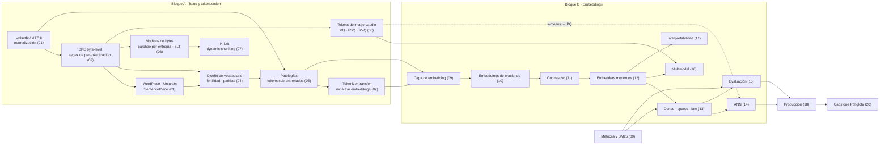

# Guía de estudio · Tokenización y Embeddings: de BPE a los modelos modernos

Cómo recorrer el curso, cuánto tiempo dedicar a cada módulo, qué conceptos dependen de cuáles y un glosario
ES/EN. Duración total ≈ 104 h; ritmo sugerido de **8 h/semana**, unas 13 semanas.

## 1. Cómo estudiar cada módulo

1. **Antes de empezar (10 min):** responde de memoria la caja **🔁 Conexión con módulos anteriores** sin desplegar
   las respuestas. Si fallas más de una, repasa esa sección del módulo citado antes de seguir.
2. **Lección:** sigue la caja **🧭 Ruta núcleo vs ampliación** si la hay (módulos 01, 02, 03, 05 y 06). El núcleo
   es lo que necesita el proyecto; la ampliación puede esperar a la semana siguiente (eso ya es repaso espaciado).
3. **Ejemplos a mano:** hazlos con papel *antes* de ejecutar la celda que los comprueba.
4. **👀 Qué debes observar:** léela después de mirar el gráfico, no antes. Primero escribe tu propia conclusión.
5. **Celdas Gemini (🎨/🎬):** si aún no has generado la imagen, el *placeholder* (ASCII) basta para seguir la lección.
6. **Proyecto:** intenta cada TODO al menos 15 min antes de abrir **🪜 Pista 1**, y la Pista 2 solo después. La
   solución tras **⛔ SPOILER** sirve para comparar, no para copiar.
7. **Autoevaluación:** prioriza las preguntas marcadas **(Cálculo)**, **(Diagnóstico)** y **(Transferencia)**.
8. **Repaso espaciado:** al empezar cada semana, vuelve a la autoevaluación del módulo de hace **dos semanas**.

> **Datos sintéticos.** Si no hay red (o Hugging Face está bloqueado), los notebooks usan un corpus de respaldo y lo
> avisan con ⚠️. El código y los conceptos son los mismos; solo cambian los números. Los umbrales de las rúbricas
> están calibrados con el corpus que indica cada proyecto: con datos reales, fíjate en los criterios **relativos**
> (A mejor que B) más que en los absolutos.

## 2. Ruta y tiempos (00–20)

| Semana | Módulo | Nivel | Horas | GPU | Pieza de Políglota | Requiere |
|---|---|---|---|---|---|---|
| 1 | 00 · Intro, entorno e hilo conductor | 🟢 | 2 | CPU | corpus + BM25 + golden set | — |
| 1 | 01 · Unicode, UTF-8, normalización | 🟢 | 4 | CPU | auditoría Unicode + normalizador | 00 |
| 2 | 02 · BPE desde cero | 🟡 | 5 | CPU | BPE propio verificado con tiktoken | 01 |
| 2–3 | 03 · WordPiece, Unigram, SentencePiece | 🟡 | 5 | CPU | comparación de 3 tokenizers | 02 |
| 3 | 04 · Diseño de tokenizers modernos | 🟠 | 5 | CPU | receta de vocabulario (mezcla + V) | 03 |
| 4 | 05 · Patologías y robustez | 🟠 | 5 | CPU/T4 | detector de tokens sub-entrenados + fuzzer | 01, 04 |
| 4–5 | 06 · Tokenizer-free I: bytes y BLT | 🔴 | 5 | T4 (CPU en FAST_DEV) | patcher entrópico vs BPE | 02, 05 |
| 5 | 07 · H-Net y tokenizer transfer | 🔴 | 6 | L4 rec. (CPU en FAST_DEV) | cambiar el tokenizer de un modelo | 05, 06 |
| 6 | 08 · Tokens multimodales y audio | 🟠 | 6 | T4 | tokens VQ de imagen y audio | 02, 06 |
| 7 | 09 · Capa de embedding en LLMs | 🟡 | 5 | CPU/T4 | análisis de embeddings + vocab de dominio | 05, 07 |
| 7 | 10 · Embeddings contextuales y de oraciones | 🟡 | 5 | CPU/T4 | pooling y whitening en retrieval | 09 |
| 8 | 11 · Aprendizaje contrastivo | 🟠 | 6 | L4/A100 rec. (T4 en FAST_DEV) | embedder ES/EN propio | 10 |
| 9 | 12 · Embedders modernos | 🟠 | 5 | T4/L4 | comparativa con Matryoshka y cuantización | 11 |
| 9 | 13 · Dense, sparse y late interaction | 🟠 | 5 | T4 | retrieval híbrido + reranking | 00, 12 |
| 10 | 14 · Indexación y ANN | 🟠 | 5 | CPU/T4 | índice con curvas recall/latencia/memoria | 08, 13 |
| 10–11 | 15 · Evaluación de retrieval | 🟠 | 5 | CPU | banco de evaluación con IC | 00, 13 |
| 11 | 16 · Embeddings multimodales | 🟠 | 5 | L4 rec. (T4 en FAST_DEV) | búsqueda en PDFs con imágenes | 08, 12 |
| 12 | 17 · Interpretabilidad y geometría | 🔴 | 5 | T4/L4 | SAE sobre embeddings | 09, 12 |
| 12 | 18 · Producción | 🟠 | 5 | CPU/T4 | servicio con caché y versionado | 14, 15 |
| 13 | 19 · Playbook de élite | 🔴 | 4 | CPU | 3 casos de system design | todo |
| 13 | 20 · Capstone: Políglota completo | 🔴 | 6 | T4/L4 | Políglota completo | todo |

Bloque A (00–08) ≈ 43 h · Bloque B (09–17) ≈ 46 h · Producción y cierre (18–20) ≈ 15 h.

**Rutas abreviadas** (si tienes un objetivo concreto):
- *Solo tokenización para LLMs:* 00 → 01 → 02 → 03 → 04 → 05 → 07 (§tokenizer transfer) → 09.
- *Solo búsqueda semántica:* 00 → 01 (núcleo) → 02 (núcleo) → 10 → 11 → 12 → 13 → 14 → 15 → 18.
- *Entrevistas:* autoevaluaciones de todos los módulos + 19 + `extras/GUIA_ENTREVISTAS.md`.

## 3. Mapa de conceptos

Ideas que atraviesan el curso (vuelve a ellas en cada módulo):
- **Compresión:** BPE (02) es un compresor voraz; bits por byte (01, 02, 06) mide la tasa; BLT (06) reparte el
  cómputo según la entropía; VQ (08) es compresión con pérdida; PQ (14) comprime vectores.
- **IR/recsys:** índice invertido y BM25 (00) → sparse aprendido (13); *cold start* de ítems ↔ inicializar tokens
  nuevos (07, 09); two-tower ↔ bi-encoder (10–11); k-means ↔ VQ (08) ↔ IVF/PQ (14).
- **Lingüística:** grafemas y escrituras (01), morfología y fronteras (03), fertilidad y «token tax» por idioma (04).
- **Medir bien:** nDCG con convenciones fijas e IC bootstrap (00) → evaluación a fondo (15).

## 4. Glosario ES/EN · Bloque A (00–08)

| Español (como se usa en el curso) | Inglés | Definición breve | Módulo |
|---|---|---|---|
| token | token | unidad discreta de un vocabulario, con un id entero | 00 |
| tokenizer (m.) | tokenizer | componente que convierte texto en ids y de vuelta; no se usa «tokenizador» | 00 |
| embedding | embedding | vector denso aprendido asociado a una unidad o a un texto | 00 |
| índice invertido | inverted index | término → lista de (documento, frecuencia) | 00 |
| BM25 | BM25 (Okapi BM25) | puntuación léxica con IDF, saturación ($k_1$) y normalización por longitud ($b$) | 00 |
| ganancia acumulada descontada normalizada | nDCG@k | calidad de un ranking con descuento logarítmico por posición | 00 |
| exhaustividad en k | Recall@k | fracción de relevantes recuperados en el top-k | 00 |
| rango recíproco medio | MRR@k | media de 1/posición del primer relevante | 00 |
| conjunto de referencia | golden set / qrels | consultas con sus documentos relevantes anotados | 00 |
| intervalo de confianza bootstrap | bootstrap CI | IC obtenido remuestreando consultas con reemplazo | 00 |
| punto de código | code point | número que Unicode asigna a un carácter (U+00F1) | 01 |
| grafema | grapheme cluster | lo que el lector percibe como «un carácter» | 01 |
| normalización (NFC/NFD/NFKC/NFKD) | Unicode normalization | formas canónicas o de compatibilidad del mismo texto | 01 |
| homoglifo | homoglyph / confusable | carácter visualmente igual a otro de otra escritura | 01 |
| mojibake | mojibake | texto corrompido por decodificar con la codificación equivocada | 01 |
| codificación por pares de bytes | Byte Pair Encoding (BPE) | fusiona iterativamente el par adyacente más frecuente | 02 |
| merge (sust. m., pl. *merges*); verbo «fusionar» | merge | regla aprendida (a, b) → ab; su orden forma parte del tokenizer. «Fusión» = el acto de aplicar un merge | 02 |
| pre-tokenización; el componente es el **pre-tokenizer** (m.) | pre-tokenization / pre-tokenizer | partición previa (regex) dentro de la cual se aplican los merges | 02 |
| BPE a nivel de byte | byte-level BPE | BPE con alfabeto inicial de 256 bytes: sin `[UNK]` | 02 |
| tokens especiales | special tokens | tokens de control (`<|endoftext|>`, roles de chat) | 02, 04 |
| WordPiece | WordPiece | fusiona por ganancia de verosimilitud; inferencia *longest-match-first* (`##`) | 03 |
| modelo de lenguaje unigrama | Unigram LM | vocabulario grande que se poda con EM; segmentación por Viterbi | 03 |
| regularización de subpalabras | subword regularization / BPE-dropout | muestrear segmentaciones distintas al entrenar | 03 |
| pipeline del tokenizer (m.) | tokenizer pipeline | normalizer → pre-tokenizer → model → post-processor → decoder | 03 |
| fertilidad | fertility | tokens por palabra | 03, 04 |
| bytes por token | bytes per token | bytes UTF-8 cubiertos por cada token (compresión) | 02–04 |
| **prima de tokens** (por idioma); paridad = prima ≈ 1 | tokenization premium / parity (coloquial: «token tax») | tokens de un idioma ÷ tokens del inglés para el mismo contenido. Forma canónica del curso: no se usa «impuesto» | 00, 02, 04 |
| prima de bytes | — | bytes UTF-8 extra que paga una escritura frente al ASCII por la misma información | 01, 06 |
| plantilla de chat | chat template | formato con roles y tokens especiales que se tokeniza | 04 |
| tokens que cruzan palabras | superword tokens (SuperBPE) | merges que atraviesan espacios | 04 |
| token sub-entrenado / glitch | under-trained / glitch token | token del vocabulario que el modelo casi no vio al entrenar | 05 |
| curación de la frontera del prompt | token healing | retroceder un token y restringir la generación al prefijo | 05 |
| inyección de tokens | token injection / smuggling | colar tokens de control o texto invisible en la entrada | 05 |
| fuzzing por propiedades | property-based fuzzing | generar entradas y comprobar invariantes | 05 |
| bits por byte (abrev. **bpb**, en minúscula) | bits per byte (bpb) | entropía cruzada normalizada por bytes: compara tokenizaciones distintas | 06, 07 |
| parche | patch | grupo de bytes que procesa un paso del transformer global | 06 |
| parcheo por entropía | entropy-based patching | abrir parche cuando $H(x_i)$ supera un umbral | 06 |
| parcheo incremental | incremental patching | la segmentación del prefijo no depende del futuro | 06 |
| troceado dinámico | dynamic chunking (H-Net) | fronteras aprendidas de extremo a extremo con un *router* | 07 |
| estimador de paso directo | straight-through estimator (STE) | forward discreto, backward como identidad | 07, 08 |
| transferencia de tokenizer | tokenizer transfer | cambiar el vocabulario de un modelo ya entrenado | 07 |
| FVT / FOCUS / WECHSEL / ZeTT | (igual) | métodos para inicializar los embeddings del vocabulario nuevo | 07 |
| cuantización vectorial | vector quantization (VQ) | sustituir un vector por su centroide más cercano del codebook | 08 |
| libro de códigos | codebook | conjunto de K vectores (centroides) del cuantizador | 08 |
| pérdida de compromiso | commitment loss | término que ancla el encoder a su código elegido | 08 |
| cuantización escalar finita | finite scalar quantization (FSQ) | redondear cada dimensión a pocos niveles: sin codebook aprendido | 08 |
| cuantización vectorial residual | residual VQ (RVQ) | cuantizadores en cascada sobre el residuo | 08 |
| códec neuronal | neural audio codec | SoundStream, EnCodec, Mimi: audio → tokens discretos | 08 |
| tasa-distorsión | rate-distortion | compromiso entre bits (bpp, kbps) y calidad (PSNR, SNR) | 08 |

**Convenciones de escritura del bloque A** (pasada de consistencia): *coste/costes* (no «costo»), *video* (no «vídeo»), tuteo singular; grafías oficiales: GPT-2, Llama 3, SentencePiece, `tiktoken`, Hugging Face, ByT5, MegaByte (MEGABYTE en el título del paper), H-Net, EnCodec, SoundStream, FLORES-200/FLORES+. Detalle en `_tools/REVISION_CONSISTENCIA.md`.

## 5. Bloque B (09–20) · para ampliar por el revisor pedagógico B

> Esta sección la completa el revisor pedagógico del bloque B: glosario ES/EN de los términos de 09–20 (pooling,
> anisotropía, InfoNCE, hard negatives, Matryoshka, SPLADE, MaxSim, HNSW, IVF-PQ, RRF, modality gap, SAE…),
> rutas abreviadas adicionales y cualquier ajuste de tiempos tras la revisión.

| Español | Inglés | Definición breve | Módulo |
|---|---|---|---|
| *(pendiente)* | | | |
