# Tokenización y Embeddings: de BPE a los modelos modernos

Curso de **21 módulos (≈ 104 h)** en notebooks de Google Colab: de cómo un texto se convierte en bytes y tokens, hasta
cómo se entrenan, evalúan, indexan y sirven los embeddings en los modelos actuales, con estado del arte hasta
**octubre 2026** y cada técnica etiquetada como 🟢 sólido / 🟡 emergente / 🔴 experimental.

Cada módulo tiene una **lección** (teoría + implementación desde cero + librerías de industria + 🏭 producción + 🧠 secretos
de la élite + autoevaluación) y un **proyecto** (plantilla con TODOs, pistas graduadas, rúbrica y solución oculta) que
hace crecer **Políglota**, un buscador semántico multilingüe (ES/EN/código).

> **Estado:** completo (21 módulos con lección y proyecto, revisados técnica, pedagógica, ejecutable y editorialmente).
> Los badges de Colab apuntan a la rama `master` y funcionarán tras el merge de la rama
> `claude/tokenization-embeddings-course`.

## Mapa del curso

```mermaid
flowchart LR
  subgraph A[Bloque A · Texto y tokenización]
    A0[00 Intro] --> A1[01 Unicode y bytes] --> A2[02 BPE] --> A3[03 WordPiece/Unigram/SP]
    A3 --> A4[04 Diseño de tokenizers] --> A5[05 Patologías]
    A5 --> A6[06 Bytes y BLT] --> A7[07 H-Net y transfer] --> A8[08 Tokens multimodales/audio]
  end
  subgraph B[Bloque B · Embeddings]
    B9[09 Capa de embedding] --> B10[10 Contextuales y oraciones] --> B11[11 Contrastivo]
    B11 --> B12[12 Embedders modernos] --> B13[13 Dense/sparse/late] --> B14[14 ANN]
    B14 --> B15[15 Evaluación] --> B16[16 Multimodal] --> B17[17 Interpretabilidad]
    B17 --> B18[18 Producción] --> B19[19 Playbook] --> B20[20 Capstone]
  end
  A8 --> B9
```

## Módulos
| # | Módulo | Nivel | ≈ h | GPU | Proyecto Políglota |
|---|---|---|---|---|---|
| 00 | Intro, entorno e hilo conductor | 🟢 | 2 | CPU | Corpus + baseline BM25 |
| 01 | Texto como bytes: Unicode, UTF-8, normalización | 🟢 | 4 | CPU | Auditoría Unicode |
| 02 | BPE desde cero | 🟡 | 5 | CPU | BPE propio |
| 03 | WordPiece, Unigram, SentencePiece, tiktoken, HF tokenizers | 🟡 | 5 | CPU | Comparar 3 tokenizers |
| 04 | Diseño de tokenizers modernos | 🟠 | 5 | CPU | Benchmark de fertilidad/paridad |
| 05 | Patologías y robustez | 🟠 | 5 | CPU/T4 | Detector de glitch tokens |
| 06 | Tokenizer-free I: bytes y patches (BLT) | 🔴 | 5 | T4 | Mini patcher entrópico |
| 07 | Tokenizer-free II: H-Net y tokenizer transfer | 🔴 | 6 | L4 | Cambiar el tokenizer de un modelo |
| 08 | Tokens multimodales y de audio | 🟠 | 6 | T4 | Tokenizar imagen y audio |
| 09 | La capa de embedding en LLMs | 🟡 | 5 | CPU/T4 | Análisis de la capa de embedding |
| 10 | Embeddings contextuales y de oraciones | 🟡 | 5 | CPU/T4 | Pooling y whitening |
| 11 | Aprendizaje contrastivo | 🟠 | 6 | L4/A100 | Tu embedder ES/EN |
| 12 | Embedders modernos (Matryoshka, cuantización) | 🟠 | 5 | T4/L4 | Comparativa de embedders |
| 13 | Dense vs sparse vs late interaction | 🟠 | 5 | T4 | Retrieval híbrido |
| 14 | Indexación y ANN | 🟠 | 5 | CPU/T4 | Índice recall/latencia |
| 15 | Evaluación de embeddings y retrieval | 🟠 | 5 | CPU | Banco de evaluación |
| 16 | Embeddings multimodales | 🟠 | 5 | L4 | ColPali sobre PDFs |
| 17 | Interpretabilidad y geometría | 🔴 | 5 | T4/L4 | SAE sobre embeddings |
| 18 | Producción | 🟠 | 5 | CPU/T4 | Servicio con migración |
| 19 | Playbook de élite | 🔴 | 4 | CPU | System design |
| 20 | Capstone: Políglota completo | 🔴 | 6 | T4/L4 | Integración |

## Material de apoyo
- [Guía de estudio](GUIA_DE_ESTUDIO.md): ruta, tiempos, rutas abreviadas, mapa de conceptos y glosario ES/EN de ambos bloques.
- [Guía de entrevistas](extras/GUIA_ENTREVISTAS.md): preguntas de tokenización, embeddings y *system design* con respuesta modelo y rúbrica.
- [Lectura de papers](extras/LECTURA_PAPERS.md): lecturas por módulo, priorizadas, con preguntas guía.
- [Índice de recursos Gemini](extras/GEMINI_ASSETS.md): todas las celdas 🎨/🎬 del curso con su prompt.
- Curso hermano: [`recsys-course/`](../recsys-course/) (los módulos 09–16 enlazan con sus lecciones de evaluación, two-tower y ANN).

## Stack
PyTorch · Hugging Face (`transformers`, `tokenizers`, `datasets`) · `tiktoken` · `sentencepiece` · `sentence-transformers` ·
`faiss` · `mteb` · una vector DB ligera (Qdrant o pgvector) en el módulo 18.

## Datasets
Wikipedia ES/EN, FLORES-200, BEIR (SciFact, FiQA), MIRACL-es, mMARCO, CodeSearchNet, COCO, ViDoRe, LibriSpeech pequeño.
Cada notebook usa la cadena **oficial → espejo → sintético con el mismo esquema** y avisa cuando corre con datos sintéticos.

## Cómputo
Colab Pro. Todo corre en T4 o CPU salvo los módulos marcados (07, 11, 16 recomiendan L4/A100). Cada notebook indica GPU y
unidades estimadas, y tiene `FAST_DEV_RUN` para iterar rápido.

## Imágenes y videos con Gemini
Las lecciones tienen celdas **🎨 GEMINI-IMAGEN** / **🎬 GEMINI-VIDEO** con ID (`M04-IMG-02`), prompt listo para copiar,
formato esperado, texto alternativo e instrucciones exactas de inserción; mientras no las reemplaces muestran un
placeholder. Todas están indexadas en [`extras/GEMINI_ASSETS.md`](extras/GEMINI_ASSETS.md) (se regenera con
`python tokenization-embeddings-course/_tools/gen_gemini_index.py`).

## Cómo estudiar
1. Lee la lección con el notebook abierto; ejecuta cada celda y responde las preguntas de recuperación 🔁 antes de
   mirar las respuestas.
2. Haz el proyecto **sin mirar la solución**; usa las pistas 🪜 en orden. La solución está tras ⛔ SPOILER.
3. Cierra con la autoevaluación y los retos extra. Cada proyecto alimenta el siguiente: no te saltes módulos.
4. Se recomienda ~8 h/semana (≈ 3 meses).

## Documentos de diseño
`_tools/COURSE_SPEC.md` · `_tools/SYLLABUS.md` · `_tools/STYLE_GUIDE.md` · `_tools/progress/PROTOCOL.md`
